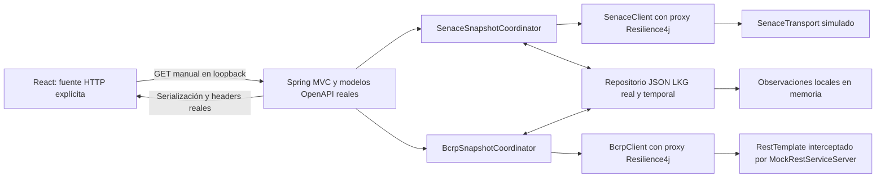

# EcoInvest — Validación integral LKG, Bloque 4

Fecha de ejecución y reporte: **12/11/2026**. Entorno: Windows, zona America/Lima.

## 1. Resumen ejecutivo

Se validó el mecanismo Last Known Good mediante pruebas backend aisladas y un recorrido **React → HTTP local real → Spring MVC → coordinadores LKG → clientes con AOP Resilience4j → transportes artificiales → archivos JSON persistentes**.

Resultados principales:

- Compilación backend offline satisfactoria con Oracle JDK 17.0.12.
- Regresión backend: 314 casos contabilizados; 313 satisfactorios y uno omitido deliberadamente porque requería una activación HTTP independiente.
- Ejecución posterior de `LkgLocalHarnessTest` con HTTP habilitado: seis casos satisfactorios, cero fallos, errores u omisiones.
- Frontend: typecheck, 191 pruebas y build satisfactorios.
- Doce recorridos completos de navegador satisfactorios; 144 comprobaciones de vista/resolución, sin desbordamiento horizontal global detectado.
- Persistencia verificada entre JVM distintas: tres JSON conservados y hashes idénticos después de recuperar los respaldos.
- Verificados respaldos individuales y combinados, ausencia, antigüedad, vencimiento, corrupción y respuesta inválida.
- Procesos del laboratorio cerrados; puertos 8081, 5173 y de control del navegador liberados al finalizar.

**No se consultaron SENACE ni BCRP oficiales.** Los cuerpos upstream fueron artificiales. No se cargaron credenciales, no se inició la aplicación productiva completa y el contexto de pruebas excluyó DataSource/JPA. No hubo despliegue ni activación productiva de LKG.

Las cifras de suites diferentes se presentan separadas: no representan una única suite acumulada. La validación local no certifica disponibilidad del proveedor, durabilidad en nube ni cobertura oficial del dataset.

## 2. Estado inicial y antecedentes

El mecanismo existente se tomó de los siguientes reportes y se contrastó con el código:

- [Bloque 1: repositorio JSON](REPORTE_IMPLEMENTACION_LKG_BLOQUE1.md).
- [Bloque 2: coordinación SENACE/BCRP](REPORTE_IMPLEMENTACION_LKG_BLOQUE2.md).
- [Bloque 3A: activación y contrato público](REPORTE_IMPLEMENTACION_LKG_BLOQUE3A.md).
- [Bloque 3B: adaptación React](REPORTE_IMPLEMENTACION_LKG_BLOQUE3B.md).
- [Contrato OpenAPI](../backend/src/main/resources/openapi.yaml).
- [Perfil integracion-local](../backend/src/main/resources/application-integracion-local.yml).

Las pruebas MockMvc y los transportes inyectados exclusivamente en React no acreditaban por sí solos el recorrido de navegador a servidor HTTP ni un reinicio completo de JVM. Este bloque agregó esa evidencia sin reconstruir las funcionalidades existentes.

El índice documental conserva referencias históricas anteriores al estado actual; no se actualizó porque esa edición no formó parte de la autorización.

## 3. Arquitectura efectivamente utilizada



Componentes reales: controlador, `LkgPublicMapper`, clientes, coordinadores, repositorio JSON, validadores, DTOs, mapper, Jackson/JsonNullable, modelos generados y aspectos/circuit breakers.

Sustituciones exclusivas del laboratorio:

| Borde | Sustitución | Aislamiento |
|---|---|---|
| SENACE | Mock de `SenaceTransport` antes de construir `SenaceClient` | No se construye su cliente HTTP productivo para acceder al proveedor. |
| BCRP | `MockRestServiceServer` enlazado al `RestTemplate` antes de entregarlo a `BcrpClient` | La fábrica intercepta las solicitudes; las no previstas se rechazan, sin fallback a red. |
| Tiempo LKG | `Clock` UTC con desplazamiento controlado | Permite probar antigüedad sin esperar días ni cambiar el reloj de Windows. |

No hay endpoints de simulación en producción. El proceso de prueba recibe comandos por stdin. Los nombres `DIRECT`, `FAIL_SENACE`, `FAIL_BCRP`, `FAIL_BOTH`, `INVALID` y otros identifican escenarios artificiales, no observaciones oficiales.

El encabezado exclusivo del harness `X-EcoInvest-Lab: ARTIFICIAL` permite que el controlador de navegador rechace un backend ordinario por error. No forma parte del contrato productivo.

## 4. Archivos creados y alcance de cambios

| Archivo | Responsabilidad |
|---|---|
| [LkgLocalHarness.java](../backend/src/test/java/com/ecoinvest/soa/integration/lkg/LkgLocalHarness.java) | Servidor HTTP mínimo, configuración cerrada, proveedores controlados, reloj y comandos locales. |
| [LkgLocalHarnessTest.java](../backend/src/test/java/com/ecoinvest/soa/integration/lkg/LkgLocalHarnessTest.java) | Validación del harness, fixtures, configuración, HTTP opt-in y reconstrucción del contexto sobre archivos persistentes. |
| [lkg-local-http.mjs](../frontend/tests/integration/lkg-local-http.mjs) | Navegador CDP, presupuestos locales, comprobación de respuestas, interacciones y evidencia responsive. |
| Este reporte | Consolidación documental autorizada después de ejecutar las validaciones. |

El script de navegador se amplió durante la revisión con casos de antigüedad/corrupción, capturas de los paneles inferiores e interacciones locales. También se corrigió el envío de Enter del controlador de pruebas.

No se modificaron código productivo, OpenAPI, políticas Resilience4j, dependencias ni reportes históricos en este bloque. Los cambios LKG preexistentes del árbol de trabajo se conservaron. `target/`, `.api-test-build/` y `dist/` recibieron únicamente las salidas de las herramientas autorizadas, sin edición manual de artefactos generados.

## 5. Configuración y aislamiento

Configuración efectiva del laboratorio:

```properties
spring.profiles.active=integracion-local
server.address=127.0.0.1
server.port=8081
ecoinvest.snapshots.enabled=true
ecoinvest.snapshots.senace-stale-after=PT24H
ecoinvest.snapshots.senace-max-age=P90D
ecoinvest.snapshots.bcrp-stale-after=P7D
ecoinvest.snapshots.bcrp-max-age=P365D
```

El perfil conserva las exclusiones:

```text
org.springframework.boot.autoconfigure.jdbc.DataSourceAutoConfiguration
org.springframework.boot.autoconfigure.orm.jpa.HibernateJpaAutoConfiguration
org.springframework.boot.autoconfigure.data.jpa.JpaRepositoriesAutoConfiguration
```

El harness utiliza configuración explícita y una lista cerrada de autoconfiguraciones web/AOP/Jackson. No hace component scanning de `SoaApplication`. Antes de refrescar el contexto comprueba perfil único, bind, puerto y exclusiones; rechaza definiciones DataSource, EntityManager y EntityManagerFactory. Después del arranque exige proxies AOP de ambos clientes. El test HTTP comprobó además la ausencia de esos beans.

Las fuentes de propiedades de sistema y entorno se retiran del Environment de Spring del harness; los valores de laboratorio se aportan explícitamente. No se importa `.env`, `.env.apis.local` ni configuración adicional. La propiedad SENACE de credencial permanece vacía. No se modificó configuración persistente de Windows.

La aplicación productiva mantiene su configuración histórica de persistencia; este reporte **no autoriza arrancarla sin el aislamiento evaluado**. La evidencia de ausencia de SQLite se basa en el contexto mínimo y los beans ausentes, no en abrir o inspeccionar una base de datos.

Frontend del laboratorio:

```properties
VITE_API_MODE=http
VITE_API_BASE_URL=http://127.0.0.1:8081
VITE_HTTP_FEATURES=monitor,consultoras,dashboard,explorador
```

Estas variables se establecieron en el proceso Node. No se editaron archivos de entorno. React utilizó su cliente y adaptadores existentes, sin fetch de datos inyectado por el navegador y sin fallback a sus fixtures.

## 6. Directorios y datos artificiales

Directorio autorizado, conservado al finalizar:

```text
C:\Users\adrie\AppData\Local\Temp\ecoinvest-lkg-b4-032ea9f671be4adca3aebc913bb5ec30
```

Contenido relevante:

```text
snapshots/                       JSON de la primera secuencia y del reinicio
ecoinvest-lkg-b4-missing/         Secuencia aislada sin respaldo y posteriores fixtures
test-classpath.txt               Classpath de prueba; no contiene valores de credenciales
consultoras-valid-test-copy.json Copia artificial para revertir corrupción controlada
browser-profile/                 Perfil propio de Edge, ya cerrado
evidence/                        Resúmenes, hashes y capturas artificiales
```

No se utilizó el directorio productivo de snapshots. El harness solo admite raíces dedicadas dentro del temporal y rechaza enlaces simbólicos detectables y destinos fuera de ese ámbito. Es un control de laboratorio, no una garantía de aislamiento frente a un atacante local que manipule concurrentemente junctions/ancestros de Windows.

Fixtures utilizados:

- Cartera: 45 filas artificiales, con los 13 campos oficiales; 22 con estado Aprobado, RUC textual, coordenadas decimales, coincidencias exactas y nueve filas sin coordenadas.
- Consultoras: 24 filas artificiales repetidas con los ocho campos oficiales, vacíos y ausencias; sin identidad empresarial ni vigencia administrativa inventadas.
- BCRP: serie `PM04974AA`, período 2017, valor artificial `1.25`. El período 2018 se usó como solicitud negativa de respaldo exacto en el test Java.

Las consultas Dashboard de navegador usaron `sector=Hidrocarburos&anio=2017`. Son parámetros de la prueba, no un nuevo catálogo de negocio. El año sigue significando año de FECHA_INICIO.

## 7. Comandos y ejecuciones acreditadas

### 7.1 Backend offline

Directorio: `backend/`. Configuración de runtime limitada al proceso:

```powershell
$env:JAVA_HOME = 'C:\Program Files\Java\jdk-17'
$env:PATH = "$env:JAVA_HOME\bin;$env:PATH"
java -version
.\mvnw.cmd -o -version
.\mvnw.cmd -o -DskipTests compile
.\mvnw.cmd -o "-Dtest=*Snapshot*Test,Lkg*Test,EcoInvestControllerTest,SenaceClientTest,BcrpClientTest,SenaceIntegrationTest" test
```

Runtime observado: Oracle Java 17.0.12, Maven Wrapper con Maven 3.9.9. OpenAPI Generator 7.4.0 regeneró los modelos.

| Ejecución del 12/11/2026 | Resultado |
|---|---|
| Compilación, final 08:07:33 -05:00 | BUILD SUCCESS. |
| Regresión seleccionada, final 08:11:15 -05:00 | BUILD SUCCESS; 314 casos, cero fallos/errores, uno omitido. |
| HTTP opt-in, final 08:14:57 -05:00 | BUILD SUCCESS; seis casos, cero fallos/errores/omisiones. |
| Exportación de classpath, final 08:17:37 -05:00 | Un caso seleccionado satisfactorio; solo preparación de ejecución independiente. |

Comando de activación HTTP independiente:

```powershell
.\mvnw.cmd -o "-Dtest=LkgLocalHarnessTest" "-Decoinvest.lkg.local-http-test=true" test
```

El test normal no abre el servidor. La ejecución opt-in cargó el perfil real, abrió HTTP local, cerró/reconstruyó contextos y cerró el servidor. El puerto 8081 se comprobó libre después.

Para la JVM independiente se exportó el classpath mediante un método explícito del test:

```powershell
# $labRoot representa el directorio temporal indicado en la sección 6.
.\mvnw.cmd -o "-Dtest=LkgLocalHarnessTest#optionallyExportsOnlyTestClasspathToAuthorizedTemporaryRoot" "-Decoinvest.lkg.classpath-output=$labRoot\test-classpath.txt" surefire:test
$testClasspath = Get-Content -LiteralPath "$labRoot\test-classpath.txt" -Raw
& "$env:JAVA_HOME\bin\java.exe" -cp $testClasspath com.ecoinvest.soa.integration.lkg.LkgLocalHarness --run-lkg-lab $labRoot DIRECT
```

La primera ejecución independiente recibió EOF de la herramienta y terminó antes de las consultas; se reinició con terminal interactiva. `STOP` o EOF cierran el contexto. No se utilizó `spring-boot:run` ni se inició el contexto productivo completo.

### 7.2 Frontend

Directorio: `frontend/`:

```powershell
npm run typecheck
npm run test:api
npm run build
```

Resultados: typecheck sin errores; **191 pruebas satisfactorias**, cero fallos/omisiones; build satisfactorio. Node 22.16.0; Vite 8.3.5. El build procesó 51 módulos; bundle JS de 332,80 kB, 98,99 kB gzip. No se instaló ninguna dependencia.

Arranque Vite ejecutado con variables públicas explícitas dentro de Node y flags `--host 127.0.0.1 --port 5173 --strictPort`. No se habilitó un proxy que evitara comprobar CORS: el navegador consultó directamente el puerto 8081.

### 7.3 Navegador

La herramienta de control visual no pudo inicializarse por un fallo del sandbox. Se utilizó Edge headless con perfil temporal independiente y CDP enlazado a loopback, sin instalar herramientas. Puerto CDP observado: 53393.

Patrón del comando ejecutado:

```powershell
node tests/integration/lkg-local-http.mjs --run-lkg-lab http://127.0.0.1:53393 DIRECT "$labRoot\evidence"
```

Se repitió únicamente contra el laboratorio con los escenarios de la matriz siguiente y carpetas de evidencia diferenciadas. El puerto y el directorio son específicos de esta ejecución: no deben reutilizarse suponiendo que el laboratorio siga activo.

## 8. Matriz de resultados HTTP/frontend

| Escenario ejecutado | SENACE Dashboard | BCRP Dashboard | Consultoras | Resultado |
|---|---|---|---|---|
| DIRECT | API_DIRECTA_SENACE | API_DIRECTA_BCRP | 200, API_DIRECTA_SENACE, 24 filas artificiales | Satisfactorio; snapshots guardados. |
| FAIL_SENACE | RESPALDO_LOCAL | API_DIRECTA_BCRP | 200, RESPALDO_LOCAL | Fuente económica independiente. |
| FAIL_BCRP | API_DIRECTA_SENACE | RESPALDO_LOCAL | 200, API_DIRECTA_SENACE | Respaldo de la serie/período solicitados. |
| FAIL_BOTH | RESPALDO_LOCAL | RESPALDO_LOCAL | 200, RESPALDO_LOCAL | Procedencias separadas. |
| Nueva JVM, FAIL_BOTH | RESPALDO_LOCAL | RESPALDO_LOCAL | 200, RESPALDO_LOCAL | Recuperación sin respuestas upstream válidas en el proceso nuevo. |
| STALE, reloj +2 días | RESPALDO_LOCAL | RESPALDO_LOCAL | 200, respaldo antiguo SENACE | Aviso de antigüedad sin descartar datos dentro de max-age. |
| CORRUPT, JSON Consultoras alterado | RESPALDO_LOCAL | RESPALDO_LOCAL | 503, SIN_RESPALDO; lectura INVALID | Archivo corrupto no servido. |
| EXPIRED, reloj acumulado +368 días | SIN_RESPALDO | SIN_RESPALDO | 503, SIN_RESPALDO | Ambos respaldos superaron max-age; no servidos. |
| MISSING, directorio nuevo | SIN_RESPALDO | SIN_RESPALDO | 503, SIN_RESPALDO; lectura MISSING | Ausencia distinta de cero oficial. |
| INVALID, nueva JVM y sin copia SENACE | SIN_RESPALDO | API_DIRECTA_BCRP | 502, SIN_RESPALDO | Array inválido no convertido en vacío oficial. |
| DIRECT con interacciones completas | API directa artificial | API directa artificial | 200 | Búsqueda, paginación y detalle sin nuevos GET. |
| STALE con interacciones completas | RESPALDO_LOCAL | RESPALDO_LOCAL | 200, RESPALDO_LOCAL | Mismas interacciones conservando avisos y procedencia. |

En todos los casos Dashboard conservó HTTP 200, con degradación/ausencias cuando correspondía. Los arrays de error de Consultoras permanecieron arrays; React no los interpretó como cero oficial.

La corrupción fue controlada y limitada al JSON artificial de Consultoras. Se conservó una copia temporal antes de alterarlo y se restauraron sus bytes para probar después el vencimiento de una copia estructuralmente válida.

## 9. Persistencia tras reinicio completo

Secuencia acreditada:

1. La JVM PID **18008** generó los tres snapshots y ejecutó los primeros escenarios.
2. Se registraron tamaños y SHA-256 de los JSON.
3. Se envió `STOP`; el proceso terminó y el puerto quedó disponible para el siguiente arranque.
4. Se inició otra JVM, PID **3100**, sobre el mismo directorio y en `FAIL_BOTH` desde el comienzo.
5. Antes de consultar datos, Monitor devolvió `HABILITADO_SIN_VERIFICACION` y cero observaciones.
6. React recuperó proyectos, indicador BCRP y consultoras desde JSON.
7. Se compararon los hashes: **los tres archivos permanecieron idénticos**.

| Archivo bajo `snapshots/` | Bytes | SHA-256 conservado |
|---|---:|---|
| `bcrp/PM04974AA/2017.json` | 403 | `00E74D9D1B604AACBAD80F4EF8C7F4619DAE6F1511ECBFD2D22871DCB8F35F0B` |
| `senace/cartera-proyectos.json` | 15258 | `D194ADD5F1F5B6C7A32DD66B55BC3217BEDB816034E16805D36B4836ACDA8384` |
| `senace/consultoras-ambientales.json` | 5406 | `DB0A41C926F51790029189FA535F9E84D1EE87B693B41806C26EC52577995073` |

Los hashes se refieren a la captura de esa primera secuencia; no son constantes del sistema ni se espera repetirlos al generar fixtures en otra fecha.

El test Java verificó además reconstrucción de contextos, conservación de archivos, período BCRP 2018 sin copia correspondiente y rechazo de copia SENACE vencida. La prueba con PID distinto es evidencia adicional y separada de esa reconstrucción dentro de una JVM.

## 10. Contrato, procedencia y CORS

Se mantuvieron las raíces y rutas existentes. El endpoint genérico no se habilitó para el navegador de este bloque ni se extendió LKG a datastreams heredados.

Verificado mediante respuestas reales del servidor local:

- Dashboard con fuentes independientes y metadatos `lkg`, lectura, escritura, intento API y captura.
- Consultoras con array raíz, HTTP 200/502/503 y procedencia accesible desde React a través de CORS.
- Headers históricos `X-Senace-Origen`, `Estado`, `Cobertura`, `Motivo` y `Cuerpo-Completo`, más los de respaldo e intento preparados en 3A/3B.
- Captura UTC, edad informada y `antiguo` mostrados sin convertir el dato histórico en éxito nuevo del proveedor.
- `RESPALDO_LOCAL` no activó fixtures React ni se convirtió automáticamente en estado de error inutilizable.
- `SIN_RESPALDO` conservó la ausencia; no se inventaron proyectos, valores económicos o coordenadas.

Headers LKG de Consultoras considerados por el contrato/adaptador:

```text
X-Senace-Respaldo-Capturado-En
X-Senace-Respaldo-Edad-Segundos
X-Senace-Respaldo-Antiguo
X-Senace-Intento-Estado
X-Senace-Intento-Motivo
X-Senace-Snapshot-Lectura
X-Senace-Snapshot-Escritura
```

No se cambió la política CORS del servidor. Su configuración actual requiere una revisión específica antes de producción.

## 11. Monitor: interpretación de los resultados

Resultados observados:

| Situación | Estado global observado | Interpretación correcta |
|---|---|---|
| Reinicio, antes de operar | HABILITADO_SIN_VERIFICACION | Memoria vacía; no implica ausencia de archivos. |
| Escrituras/lecturas válidas | OPERATIVO | El módulo tuvo operaciones locales verificadas. |
| Consultoras corrupto | CON_INCIDENCIAS | La última lectura detectó integridad inválida. |
| Archivos ausentes en entorno nuevo | HABILITADO_SIN_VERIFICACION | Se informa NO_EXISTE/MISSING por clave sin una captura válida verificada. |
| Respaldos vencidos | OPERATIVO en esta ejecución | No implica que los archivos se puedan servir; las observaciones indican vencimiento y las consultas los rechazan. |

**Hallazgo semántico importante:** `SnapshotStatusService.state()` resume operación/integridad observada; `EXPIRED` no se clasifica por sí solo como fallo de funcionamiento del módulo. Por ello puede aparecer OPERATIVO junto a respaldos vencidos. No se cambió esta regla en el laboratorio.

Para decidir disponibilidad del dato deben leerse `lectura`, `vencido`, `antiguo`, captura y procedencia de cada consulta. El estado global no es un inventario completo ni una garantía de respaldo utilizable.

El circuito SENACE llegó a OPEN durante fallos controlados y una consulta posterior utilizó respaldo con motivo `CIRCUITO_ABIERTO`. Los contadores del transporte fueron inferiores al número de intentos protegidos, coherentemente con el rechazo AOP. No se modificaron umbrales ni se forzó un estado para presentarlo como recuperación natural.

`CLOSED`, `OPERATIVO` y HTTP 200 no certifican disponibilidad externa. `disponibilidadExterna` continuó en `NO_VERIFICADA`.

## 12. React, interacciones y responsive

Cada recorrido satisfactorio permitió un GET Dashboard, uno Consultoras y uno Monitor. La navegación/montaje no tenía presupuesto de GET. Explorador reutilizó la respuesta del Dashboard sin consulta propia.

Comprobaciones ejecutadas en los recorridos completos de interacción, tanto directos como respaldados:

- Dashboard: filtro efectivo Hidrocarburos/2017, búsqueda de una fila y cambio de página sin red adicional.
- Explorador: 20 filas visibles por página, selección de fila con Enter, ficha sincronizada, búsqueda local y máximo de 21 puntos SVG. Los puntos coincidentes conservaron agrupación; los registros sin coordenadas siguieron en los datos.
- Consultoras: diez filas por página, tercera página con cuatro filas, apertura y cierre de detalle, conservación de filas repetidas y campos opcionales.
- Monitor: consulta manual y lectura del snapshot interno, sin health checks externos.
- No se detectó activación del aviso de modo demostración React en HTTP.

Resoluciones: **1440×900, 768×1024 y 375×812**.

Agregados de los doce recorridos satisfactorios:

| Medida | Resultado |
|---|---:|
| Vista/resolución comprobadas | 144 |
| GET de datos registrados en esos recorridos | 36 |
| Solicitudes fuera del presupuesto detectadas/bloqueadas | 0 |
| Excepciones JavaScript/errores no de red registrados por el script | 0 |
| Desbordamientos horizontales globales detectados | 0 |
| PNG conservados, incluyendo intentos parciales | 204 |

Los 36 GET **no constituyen el total de toda la actividad del laboratorio**: no incluyen el intento parcial de interacción, la lectura inicial del Monitor tras reinicio, los OPTIONS de identificación, los recursos Vite ni las llamadas de los tests Java. Ninguna de esas operaciones se dirigió a proveedores oficiales.

Se inspeccionó visualmente una selección de capturas de escritorio, tablet y móvil, incluidos avisos LKG y la tabla interna del Monitor. No se afirma revisión manual individual de las 204 imágenes. La tabla del Monitor usa scroll interno en móvil; no se ocultó el desbordamiento global con una modificación CSS.

No es una auditoría WCAG completa ni una certificación visual exhaustiva contra Stitch. No se modificó el diseño existente.

## 13. Incidencias y resolución

1. **Herramienta de ejecución restringida:** el helper de Windows no pudo inicializar algunos procesos dentro del sandbox. Se utilizaron las aprobaciones de ejecución correspondientes; no se eludieron restricciones.
2. **Control visual no disponible:** `node_repl` falló antes de inicializar `@oai/sky`. Se empleó Edge/CDP local como alternativa autorizada.
3. **EOF del harness:** el primer arranque independiente cerró por falta de stdin interactivo. No recibió consultas de datos. Se reinició con terminal interactiva.
4. **Prueba de teclado inconclusa:** un recorrido de interacción se detuvo esperando la ficha después de Enter. Se ajustaron `Page.bringToFront` y el envío de Enter con su texto de control en el script. La repetición y el caso respaldado posterior pasaron. No se requirió modificar React.
5. **Avisos de compilación:** se observaron advertencias de API obsoleta del transporte y de operaciones unchecked en tests existentes; no impidieron BUILD SUCCESS. No se cambió código por esos avisos.
6. **Logs de fallo simulado:** mensajes históricos del cliente BCRP indican ausencia de respaldo en su propio fallback. La coordinación LKG ocurre fuera de ese resultado, por lo que deben interpretarse junto a la procedencia final del coordinador, no como prueba de ausencia global del mecanismo.

Los intentos parciales no se contaron como recorridos satisfactorios ni se borró su evidencia. No se detectó un defecto productivo reproducible que exigiera una corrección en este bloque.

## 14. Evidencias disponibles y cierre de procesos

Raíz de evidencia: `<directorio de la sección 6>\evidence\`.

Archivos destacados:

- `aggregate.json`: consolidación de doce resúmenes satisfactorios.
- `before-restart-hashes.json` y `restart/hash-comparison.json`: integridad antes/después del reinicio.
- `restart/initial-monitor.json`: PID anterior/nuevo, estado inicial y cero observaciones.
- `DIRECT-summary.json`, `FAIL_SENACE-summary.json`, `FAIL_BCRP-summary.json`, `FAIL_BOTH-summary.json`.
- Subdirectorios `restart`, `stale`, `corrupt`, `expired`, `missing`, `invalid`, `interactions-retry` y `backed-interactions`, con sus resúmenes y capturas.
- `interactions/`: evidencia parcial del primer intento de teclado; no contiene un resumen de éxito.

La evidencia permanece temporal en la computadora; no se copió al repositorio ni se adjuntaron cuerpos externos, variables sensibles o XML Surefire completos. Los nombres y RUC que aparecen en las capturas provienen exclusivamente de fixtures artificiales.

Se cerraron mediante STOP las JVM propias, mediante CDP el perfil Edge propio y mediante identificación del proceso Node de laboratorio el Vite correspondiente. La comprobación final no encontró listeners en 8081, 5173 ni 53393.

No se eliminaron los directorios de evidencia. Una limpieza posterior debe autorizarse, resolver y verificar la raíz exacta antes de borrar recursivamente; no debe alcanzar snapshots productivos ni otros temporales. No hace falta eliminar los tres archivos de prueba para desactivar el laboratorio: sus puntos de entrada ya exigen opt-in.

## 15. Riesgos, limitaciones y condiciones de activación real

- La frontera externa está sustituida: este bloque no valida autenticación oficial, DNS, TLS, latencia real, límites de 6 MiB ni timeouts del transporte productivo contra proveedores. Esas pruebas tienen antecedentes separados y no se reejecutaron aquí.
- No se probó una caída abrupta del sistema operativo, corte eléctrico o redeploy de contenedor. Reiniciar una JVM sobre el mismo disco local no garantiza durabilidad en otro entorno.
- Para nube es indispensable un volumen realmente persistente. Un filesystem efímero de un contenedor/plan sin disco persistente puede perder los respaldos aunque sobrevivan a un reinicio local. No se activó ni certificó LKG en Render u otro servicio.
- La memoria sigue siendo proporcional al volumen cargado; estas muestras pequeñas no constituyen un benchmark con datasets oficiales completos.
- El checksum verifica integridad interna, no autenticidad frente a un actor que pueda reescribir contenido y checksum. Se requieren permisos operativos adecuados del directorio.
- La cobertura oficial permanece NO_VERIFICADA. Cuerpo completo no equivale a universo completo del recurso.
- Coordenadas dentro de rango no certifican CRS, ubicación o cartografía oficial. Se mantuvo el SVG offline, sin tiles.
- JavaScript tiene límites para int64 y decimales. Los casos artificiales del navegador usan IDs seguros; las regresiones conservan las validaciones de precisión existentes.
- La inspección de red corresponde al navegador controlado y a los transportes interceptados; no es una auditoría de paquetes de todo Windows o del navegador fuera de esa frontera.
- Faltan una auditoría WCAG completa, revisión de seguridad/despliegue, política de acceso al directorio, espacio disponible, retención y operación persistente en el hosting elegido.
- Antes de activación real debe aceptarse explícitamente la semántica de OPERATIVO frente a EXPIRED; si se desea cambiarla, requiere un encargo de diseño/contrato, no una corrección implícita del laboratorio.

No se requiere repetir consultas oficiales para justificar los resultados de este bloque. Cualquier validación real posterior necesita presupuesto y autorización propios.

## 16. Estado final y siguiente paso

**Bloque 4 validado dentro de su alcance local con proveedores artificiales**, incluyendo integración HTTP del navegador y persistencia entre procesos Java distintos. No equivale a activación productiva ni a validación integral con proveedores oficiales.

Siguiente paso recomendado: revisar este reporte y definir por separado las condiciones operativas del almacenamiento persistente y la activación opt-in en el entorno de destino. No se inició una nueva fase, despliegue o consulta externa.

## RESULTADO PARA REVISIÓN CON CHATGPT

EcoInvest tiene LKG implementado en Bloques 1–3B y validado en Bloque 4 mediante un harness exclusivo de tests. Se crearon `LkgLocalHarness.java`, `LkgLocalHarnessTest.java` y `frontend/tests/integration/lkg-local-http.mjs`; no se cambió código productivo.

Evidencia actual: Oracle JDK 17.0.12, compilación offline BUILD SUCCESS; regresión backend de 314 casos con 313 satisfactorios y uno omitido; ejecución HTTP posterior de seis casos con seis satisfactorios; frontend typecheck, 191 tests y build satisfactorios. Son ejecuciones independientes.

React consumió HTTP real local del controlador, coordinadores y clientes proxificados. Solo los transportes upstream fueron artificiales. Doce recorridos de navegador satisfactorios cubrieron API directa artificial, fallos individuales/combinados, reinicio completo, antigüedad, corrupción, vencimiento, ausencia y formato inválido. Se registraron 144 comprobaciones responsive y cero solicitudes fuera de presupuesto/desbordamientos globales en los recorridos satisfactorios.

Persistencia: JVM 18008 cerrada y nueva JVM 3100 sobre los mismos JSON; ambos proveedores artificiales caídos desde el nuevo arranque; recuperación correcta y hashes de los tres archivos idénticos. Monitor comenzó sin observaciones, aun existiendo los archivos. Explorador reutilizó Dashboard sin un GET adicional; Consultoras mantuvo array y headers legibles por CORS; errores 502/503 no se mostraron como cero oficial.

Incidencias del laboratorio conservadas: EOF inicial y un intento de teclado inconcluso; ambos resueltos en la infraestructura de prueba, sin cambios React. Las capturas son artificiales y temporales. Los procesos se cerraron y los puertos quedaron libres.

Límite clave: OPERATIVO describe el módulo, no disponibilidad del proveedor ni utilidad de cada respaldo; se observó junto a respaldos EXPIRED que correctamente no se sirvieron. El despliegue necesita un volumen persistente real; el filesystem efímero de un contenedor no basta. No se usaron credenciales, SQLite, proveedores oficiales, commits ni despliegues. No activar LKG en producción por implicación de este reporte.
